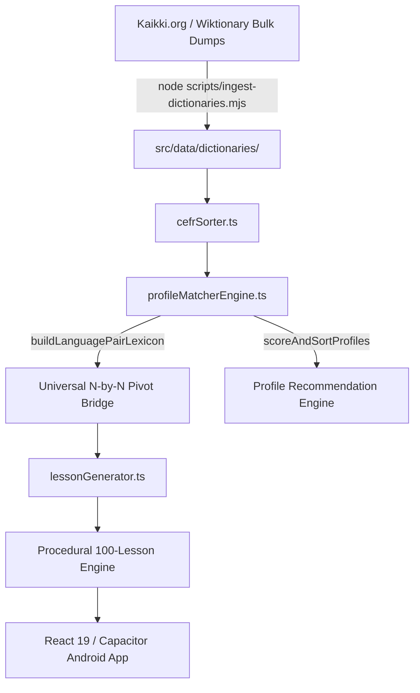

<div align="center">
  <h1>🌉 Thinking Bridge (v3.2.0 Masterpiece Release)</h1>
  <p><strong>Construct sentences directly in the target language. Think in it. Don't translate it.</strong></p>
  <p>100% Free. 100% Private. Offline-Capable Universal Language App.</p>

  <!-- Badges -->
  
  
  
  
  
</div>

---

## 🚀 What's New in v3.2.0 (Masterpiece Release)

- **Universal N-by-N Pivot Dictionary Bridge**: Bridges any of the 16 supported languages/dialects (`en`, `ar`, `arz`, `apc`, `afb`, `ary`, `de`, `ja`, `es`, `fr`, `it`, `pt`, `ru`, `zh`, `hi`, `el`) via normalized English pivot glosses ($16 \times 15 = 240$ directional language pairs $\times 6$ focus areas = **1,440 Learning Profiles**).
- **The Profile Matcher Equation**: Multi-factor profile ranking engine ($S(p,u) = 0.35\Phi + 0.25\Psi + 0.15\Omega + 0.15\Gamma + 0.10\Delta$) matching linguistic typology distance, script transferability, and daily study pace.
- **Bulk Dictionary Pipeline**: Clean Node.js ingestion pipeline (`scripts/ingest-dictionaries.mjs`) streaming Kaikki Wiktionary exports into versioned, typed dictionary modules.
- **CEFR Progression Sorter**: Automated CEFR level assigner (`cefrSorter.ts`) mapping frequency ranks (`A0`–`C2`) with survival word overrides and cognate promotion (Levenshtein similarity $\ge 0.72$).
- **Vercel Serverless Proxies**: Rate-limited, sanitized `/api/feedback` and `/api/review` serverless proxy endpoints.

---

## 🏗️ System Architecture



---

## 📖 Wiktionary & Kaikki.org Attribution

Lexical dataset data derives from **Wiktionary** via **Kaikki.org** machine-readable extracts generated using Wiktextract, licensed under Creative Commons Attribution-ShareAlike 4.0 International ([CC BY-SA 4.0](https://creativecommons.org/licenses/by-sa/4.0/)) and GNU Free Documentation License ([GFDL](https://www.gnu.org/licenses/fdl-1.3.html)).

---

## 🚀 Quick Start & Local Setup

```bash
# 1. Install dependencies
npm install

# 2. Run bulk dictionary ingestion pipeline
node scripts/ingest-dictionaries.mjs

# 3. Run development server
npm run dev

# 4. Run test suite
npm test

# 5. Build production PWA & web bundle
npm run build

# 6. Synchronize with Capacitor Android
npx cap sync android
```

---

## 📱 Android Native Build Steps

```bash
# 1. Build Android production web assets
npm run build:android

# 2. Sync to Capacitor Android native project
npx cap sync android

# 3. Assemble Debug APK
cd android
./gradlew assembleDebug
```

---

## ⚙️ Environment Variables

Create `.env` (refer to `.env.example`):

```env
DISCORD_FEEDBACK_WEBHOOK=https://discord.com/api/webhooks/YOUR_FEEDBACK_WEBHOOK_ID
DISCORD_REVIEWS_WEBHOOK=https://discord.com/api/webhooks/YOUR_REVIEWS_WEBHOOK_ID
VITE_API_BASE=https://tb-eg.vercel.app
```

---

## 📜 License

- **Codebase**: MIT License (Amr Sherif Abdelaal, 2024-Present).
- **Lexical Data**: CC BY-SA 4.0 / GFDL (Wiktionary / Kaikki.org).
