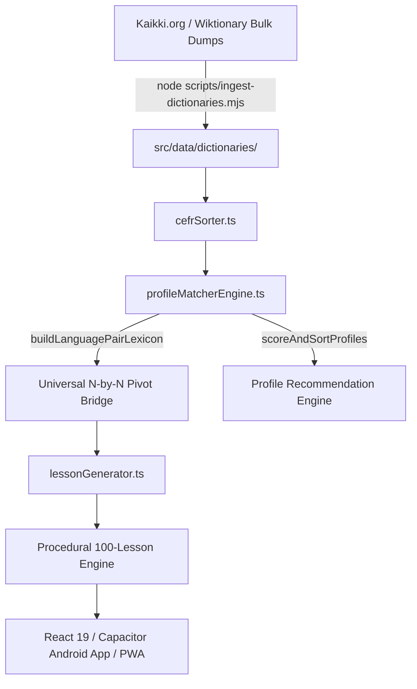

  <h1>🌉 Thinking Bridge & Thinking English™</h1>
  
<strong>Construct sentences directly in the target language. Think in it. Don't translate word-by-word.</strong>

  
🏛️ <strong>Sovereign Educational Platform · 100% Offline-First · Zero Foreign Cloud Dependencies</strong>

  
<i>Built in Alexandria, Egypt with love for learners worldwide.</i>

  <!-- Badges -->
  
  
  
  
  
  

---

## 📦 Download Thinking Bridge V6 (`v6.0.0`)

- **Live Web PWA:** [https://tb-eg.vercel.app](https://tb-eg.vercel.app) (100% offline installable Web App)
- **Quick Download Portal:** [https://tb-eg.vercel.app/apk](https://tb-eg.vercel.app/apk)
- **Direct Signed Android APK (`versionCode 6000`):** [ThinkingBridge-v6.0.0.apk](https://github.com/AmrSherifCodes/Arabic-English-Thinking-Bridge/releases/download/v6.0.0/ThinkingBridge-v6.0.0.apk) (`40.51 MB` / `42,480,041 bytes`)
- **GitHub Release & Release Notes:** [v6.0.0](https://github.com/AmrSherifCodes/Arabic-English-Thinking-Bridge/releases/tag/v6.0.0)
- **SHA-256:** `8ad98dde6fb5c3c8f7e65008e4794ae21d663de892473e8ac1eb3f85417c23f6`

---

## 🏛️ Digital Sovereignty & Privacy Principles

- **100% Offline Autonomy**: Every core pedagogical feature—from 27 interactive structural bridge lessons, 4,090 flashcards, SRS SM-2 scheduling, phonetic transliteration, to offline voice recognition—operates 100% offline without requiring active internet connectivity.
- **Zero Foreign Cloud Dependencies**: No third-party tracking, analytics, or telemetry scripts are ever introduced. All user progression, custom flashcards, and settings remain strictly local on the user's device.
- **Bring Your Own Key (BYOK) AI Architecture**: Optional AI companion features connect directly using the user's own free Google Gemini API key. Keys are obfuscated and stored exclusively in the device's local vault.
- **Channel & Media Constitution**: Governed by the [Thinking Bridge Constitution](CONSTITUTION.md) enforcing radical openness, AGPLv3 open-source copyleft protection, CC BY-NC-SA 4.0 open pedagogy, and cultural neutrality.

---

## 🚀 Key Features

- **Universal N-by-N Pivot Dictionary Bridge**: Bridges any of the 16 supported languages/dialects (`en`, `ar`, `arz`, `apc`, `afb`, `ary`, `de`, `ja`, `es`, `fr`, `it`, `pt`, `ru`, `zh`, `hi`, `el`) via normalized English pivot glosses ($16 \times 15 = 240$ directional language pairs $\times 6$ focus areas = **1,440 Learning Profiles**).
- **SM-2 Spaced Repetition System (SRS)**: Canonical SM-2 memory retention engine calculating interval progressions $I(1)=1$, $I(2)=6$, $I(n)=\text{round}(I(n-1) \cdot EF)$ with automaticity response timing.
- **Wa3i Desktop Hub**: Desktop launcher suite (`Wa3iHub` & `Wa3iCoder`) running standalone local Python applications alongside the web/PWA platform.

---

## 🏗️ System Architecture

---

## 💻 Tech Stack

- **Frontend**: React 19, Vite 8, TypeScript, Tailwind CSS, Framer Motion, Readex Pro typography.
- **Mobile Native**: Capacitor Android (`com.amrsherif.thinkingenglish`) & iOS PWA.
- **Desktop Hub**: Python 3.12, CustomTkinter, Procedural Audio, Wa3i Coder suite.
- **Local Persistence**: IndexedDB / localStorage abstraction (`storageAdapter`).

---

## 📜 Constitution, Attribution & License

- **Project Constitution**: See [CONSTITUTION.md](CONSTITUTION.md) for full governance details.
- **Pedagogical Inspiration**: Mihalis Eleftheriou and [Language Transfer](https://www.languagetransfer.org/) — for the *Thinking Method* that makes this pedagogy possible.
- **Lexical Data**: Wiktionary via Kaikki.org extracts ([CC BY-SA 4.0](https://creativecommons.org/licenses/by-sa/4.0/)).
- **Author & Founder**: Amr Sherif Abdelaal (Alexandria, Egypt).

### 🛡️ 3-Tier Anti-Theft Open Source Architecture
- **Software Code**: Licensed under **GNU Affero General Public License v3 (AGPL-3.0-or-later)**. Any hosted or redistributed forks must remain 100% open source under AGPLv3.
- **Pedagogical Content**: Educational lessons, curricula, and flashcards are licensed under **Creative Commons CC BY-NC-SA 4.0**. Free for non-commercial educational use; commercial monetization or paywalling is strictly prohibited.
- **Brand Protection**: "Thinking Bridge™", "Thinking English™", "فكّر إنجليزي™", and logos are protected trademarks of **Amr Sherif Abdelaal**. Rebranding is mandatory for any third-party fork.
